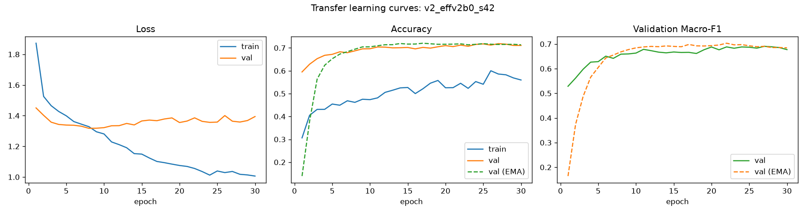
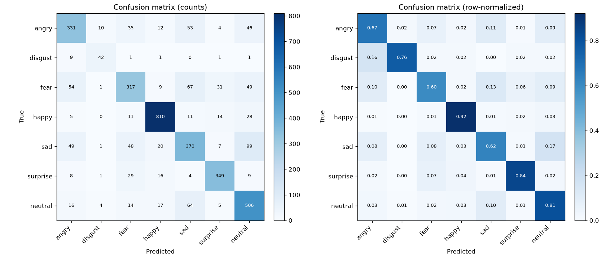
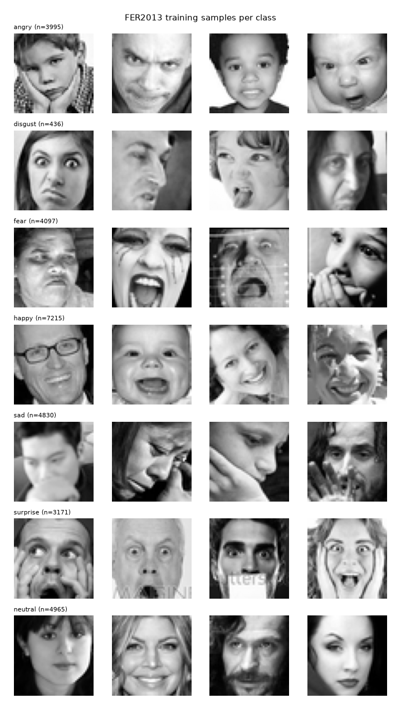
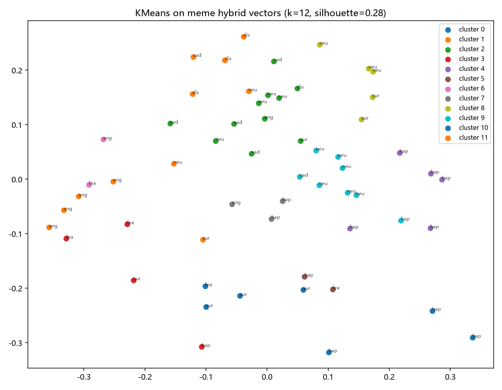

# 表情识别 + 猫 meme 匹配

用卷积神经网络识别输入人脸的 **7 类表情**（angry / disgust / fear / happy / sad / surprise / neutral），
得到情绪标签后，从一组**已标注情绪的猫 meme 表情包**里挑出**最匹配**的一张。

```
输入图片 / 摄像头 → 人脸裁剪 → CNN → 7 类情绪概率 → 检索策略 → 输出一张猫 meme
```

- 类型：课程大作业（深度学习 / 人工智能方向）
- 最终模型（EfficientNet-B0@160，v2 3-seed 集成 + TTA）测试集：**Accuracy 75.93% / Macro-F1 0.7443**
- 演示：Streamlit 单页应用（`代码/07_demo_app.py`），支持"3-seed 集成""神似模式""视觉多样性"等可选开关

## 效果预览

| 训练曲线（v2 EfficientNet-B0，30 epoch） | 测试集混淆矩阵（最终集成 + TTA） |
|---|---|
|  |  |

| FER2013 数据集示例 | 猫 meme 表情包向量聚类（检索侧分析） |
|---|---|
|  |  |

> 更多训练曲线与评估结果见 [`结果/`](结果/)。

## 仓库内容说明

为保持仓库轻量，**只包含代码、文档与实验结果摘要**；下列内容未入库：

| 未入库内容 | 原因 | 获取方式 |
|---|---|---|
| `数据/`（FER2013 / FER+、猫 meme 图片库） | 数据集体积大，且有各自许可 | Release 附件 `data-assets-v1.0.0.zip`（演示最小数据，解压到项目根即可）；原始 meme 库 / FER2013 原始文件可用 `代码/00_download_fer2013.py`、`代码/02_meme_index.py` 自行准备 |
| `模型/`（训练好的 `.pth` 权重，约 589 MB） | 体积大 | 按 `代码/05_train.py`、`代码/08_transfer_train.py` 自行训练，或向仓库所有者索取 |
| `_deps/`（timm / CLIP / mediapipe 等手工依赖与预训练权重，约 1.1 GB） | 体积大 | 按 `PROJECT.md` 第 3.3 节说明手工安装，或使用你自己的 Python 环境 |
| `结果/` 中的大图（>500 KB）、日志、`.npz` / 大 `.csv` 中间数据 | 体积大 / 可再生成 | 运行对应脚本重新生成 |

详细说明见 [PROJECT.md](PROJECT.md) 与 [交接总结.md](交接总结.md)。

## 环境与运行

1. 准备 Python 3.10+（项目在 3.14 上验证），安装 `torch`、`numpy`、`pandas`、`pillow`、`scikit-learn`、`matplotlib`、`streamlit` 等依赖；
2. 按上表准备 `数据/` 与训练好的 `模型/`；
3. 启动演示：
   - **Windows**：双击 `启动演示.bat`（若 Python 不在 PATH，先 `set "PYTHON=<python.exe 完整路径>"` 再运行）；
   - 或命令行：`python -m streamlit run 代码/07_demo_app.py --server.port 8501`
4. 打开浏览器访问 `http://localhost:8501`。

## 用 AI 助手快速部署（可选）

如果你不熟悉 Python 环境配置，可以把 [`DEPLOY_WITH_AI.md`](DEPLOY_WITH_AI.md) 里的提示词（连同本仓库链接）发给任意支持终端执行的 AI 编程助手（Cursor、Claude Code、Codex、DSH 等），由它按步骤完成环境安装、数据 / 权重准备与演示启动。

> 提示：模型权重（`model-weights-v1.0.0.zip`）与演示数据资产（`data-assets-v1.0.0.zip`）都在 Release 附件中。

## 目录结构

```
表情识别项目/
├── 代码/            # 23 个 Python 脚本：数据下载/索引、模型、训练、评估、演示等
├── 报告/            # 结题报告
├── 结果/            # 实验结果摘要：评估 JSON/TXT、混淆矩阵、训练曲线等
├── PROJECT.md       # 完整工程记录：环境、数据审查、方案、实验与排障
├── 交接总结.md       # 状态交接与经验教训
├── 启动演示.bat      # Streamlit 演示一键启动（ASCII-only）
├── README.md        # 本文件
├── LICENSE          # MIT 许可证
└── .gitignore
```

## 协作说明

本项目由 **him969** 与 AI 编程助手（DeepSeek Harness，deepseek-flash）协作完成：数据审查、方案设计、代码实现与调试、实验记录与报告撰写均在 AI 辅助下推进；人类成员负责需求提出、方向决策与最终验收。

## 许可

- 本仓库的代码与文档以 **MIT License** 发布，详见 [LICENSE](LICENSE)；
- `数据/` 中的猫 meme 图片版权归原作者，仅用于学习研究；FER2013 / FER+ 数据集请遵循其原始许可（数据本身未包含在本仓库中）。

## 说明

- 本仓库为个人学习 / 课程项目，已设为 **Public** 公开分享；
- 仓库只包含代码、文档与实验结果摘要，完整提交历史可见；数据与模型权重需按上文自行准备。
